# MyReads

Personal self-hosted library and reading tracker. Keep track of the books
you own, what you're reading, and what you thought of them, on your own
server.

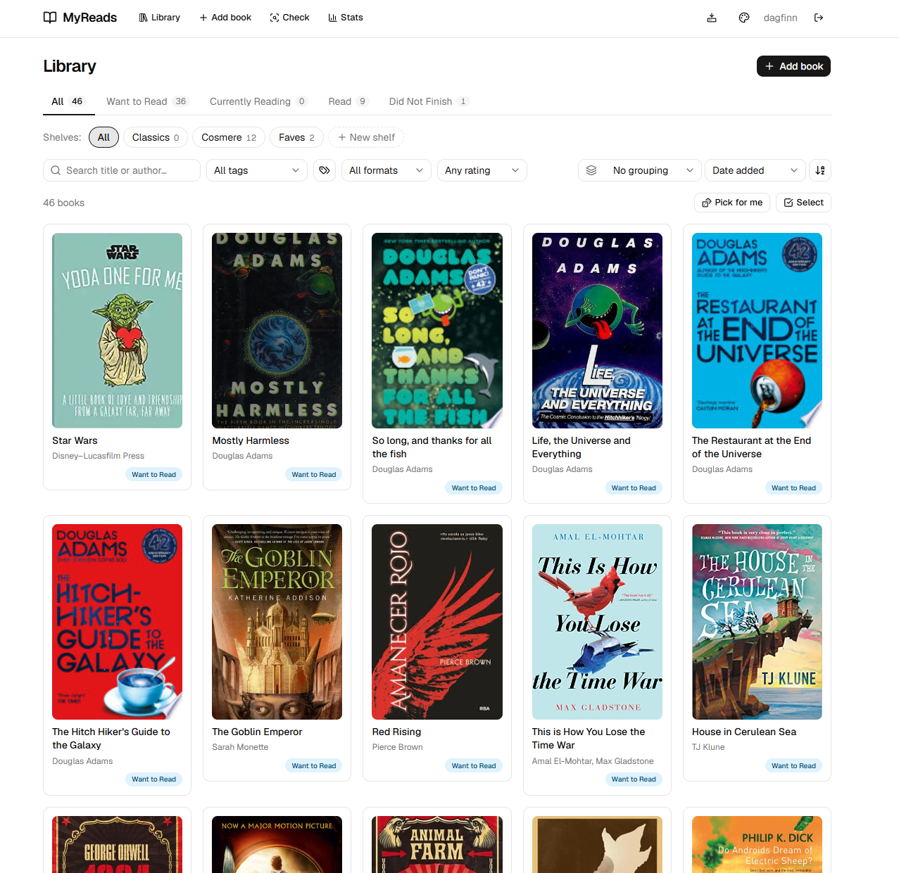

## What it does

**Adding books**

- Search by title, author or ISBN and import the details from
  [Open Library](https://openlibrary.org/), with
  [Google Books](https://developers.google.com/books) (optional) and the
  [National Library of Norway](https://api.nb.no/) as extra sources. You
  choose which of them to search and in what order. You can check and edit
  everything before saving, or type a book in by hand.
- Scan the barcode on a book with your phone's camera. Switch on Keep
  scanning to work through a whole shelf: each book is looked up and added
  as you scan it, with Undo, and books you already have are pointed out.
- "Add and add another" brings you straight back for the next book (with
  the camera open again if you scanned). In Preferences you choose what
  adding a book does: open it, add another, or go to the library.
- A book added as Read can say when you finished it, or that you don't
  remember, so years of old reading don't land in this year's stats. A book
  added as Currently Reading can say when you started and what page you're
  on.
- Subjects from the catalogues can be copied in as tags: all of them, only
  the tags you already use, or none. Renaming or removing a tag in Manage
  tags can apply to future imports too.
- "Look up details" on a book's edit page fills in what's missing, like a
  page count, from the catalogues.
- Choose a cover from the search results, paste an image link, or upload a
  photo. Covers are stored on your server.
- **Do I own this?** In a bookshop, scan a barcode on the Check page to see
  whether the book is already in your library.

**Tracking your reading**

- Status (Want to Read, Currently Reading, Read, Did Not Finish), ratings,
  notes, and start and finish dates. Rate in half stars, whole stars or out
  of 10, or switch ratings off.
- Update your current page as you go. The book page shows your pace and when
  you're likely to finish.
- Re-reads are kept as history and count in your stats.
- Save favourite quotes with page numbers, and search all of them on the
  Quotes page.

**Organising your library**

- Custom shelves, tags, series in reading order, format (physical, ebook,
  audiobook) and ownership (owned, wishlist, borrowed, no longer have it).
- Keep track of who borrowed your books and when.
- Search, filter, sort and group the library. Authors sort by surname, the
  way a bookshelf is filed. "Pick for me" opens a random book from Want to
  Read.
- A book opened from the library has an X in its corner (or press Esc) that
  takes you back to the same spot in the library, with your filters still
  on.
- Show the library as cards, bare covers or a bookshelf, in three sizes, or
  as a list, and choose what each book shows. Covers can look like little
  hardbacks, and books without a cover get one drawn with their title. Save
  the searches and filters you use often as views, and open the library on
  one of them if you like.
- Edit many books at once: set their status, format or ownership, add or
  remove tags, put them on a shelf or take them off it, or delete them.
  Pick the books on screen, or every book that matches your filters.
- Rename, merge, reorder and hide shelves, and choose which status tabs the
  library shows. Saved views can be renamed and reordered too.

**Stats**

- Books read per year, pages read, ratings, genres and formats, and a
  calendar of the days you read. Look at all time, this year, the last 12
  months or the last 30 days.
- Decide what counts: whole books when you finish them or the pages you
  log, whether books you stop reading count, and how audiobooks count.
- A "year in review" page for every year, and yearly reading goals in books
  or pages, with or without re-reads. The goal shows whether you're on
  track, and next year's can be set ahead of time.

**The reading room**

- Your library drawn as a cozy pixel-art house. Every book is a spine on a
  shelf, filed by author and coloured from its cover, with thick books on
  wide spines. Point at one to see its title, click it to open the book;
  the book's X puts it back on its shelf.
- The house grows with your library: more bookcases, then more floors, and
  furniture moves in as you add books, from a plant and a cat asleep in the
  armchair to a clock, a library ladder, a window seat and a study.
- A ribbon marks the books you're reading, and books on your wishlist, lent
  out or given away keep their place as an outline. Light themes show it by
  day; dark themes by lamplight, with the fire going.
- Decorate it: ten house styles (a cottage, a castle, a wizard's house, an
  elven hall, a cave in a hill, a space station, a modern house, a log
  cabin, a tea house and a workshop), each with its own roof, walls and
  garden, and things that move, from a banner on the battlements to a gear
  on the workshop's gable and fireflies among the birches. Pick the colour
  of the walls, the wood and the fabrics, hang a painting or one of five
  tapestries over the fireplace, put furniture away, and drag the furniture
  to wherever you like it (or move it with the arrow keys).
- Add rooms over the library, each a floor of its own: a kitchen with the
  kettle on the range, a bedroom under a patchwork quilt, a music room, a
  conservatory with a songbird, a games room with a billiard table, a
  studio with an easel, a bathroom with a bubble bath, a dining room under
  a chandelier, a nursery with a mobile over the cot, a woodshop, a sauna
  with steam rising off the stove, or a spare room to fill yourself. The
  bathroom comes tiled and the sauna panelled in logs. Their furniture
  can be moved anywhere in the house or put away like the rest.
- Paper the walls (stripes, damask, flowers, trellis, stars, stone, tiles,
  paper screens and more) and lay the floor (boards, parquet, flagstones,
  chequered tiles, carpet, tatami or a metal grate), for the whole house
  and for each added room on its own, which can have walls of its own
  colour too. String fairy lights, bunting, paper lanterns or ivy along
  the ceilings; at night the fairy lights twinkle.
- Add furniture from a catalogue: a Chesterfield sofa, a rocking chair, an
  aquarium with fish swimming in it, a spaniel asleep in its basket, a suit
  of armour, a sea chest, a coat stand, a telescope, a rocking horse, a
  curio cabinet, a spinning wheel, a bean bag, a macaw on its perch, a
  monstera, a standing mirror, a wood stove, an old radio playing, a tea
  trolley and a dollhouse. Each goes wherever there's space, and you can
  move it from there.
- Make a little you who lives there, from a wardrobe: ten skin tones (an
  elf or a spaceman too), eyes in seven colours, round or pointed ears, a
  mouth, blush or freckles, a beard, 23 hairstyles in 14 colours, three
  heights, jumpers, shirts, hoodies, a coat, a dress or a robe, trousers,
  jeans, shorts, skirts or dungarees, six kinds of shoes, 24 hats from a
  beanie to a halo (a headscarf, a turban, a head wrap and a kippah
  among them), and glasses, a monocle, an eye patch, hearing aids,
  earrings, a scarf, headphones, a backpack, a cape or fairy wings, all in
  colours of your choosing. Get about on foot, with a walking stick or in
  a wheelchair, and carry a mug of tea, a book, a lantern, a magic wand, a
  teddy bear or a sunflower. Keep up to six looks to switch between, or
  let Surprise me pick. They potter about the house
  and stop by the fire, and while you're reading a book they sit in the
  armchair reading it (the cat moves to the rug). With animations off they
  stand still by the fire.
- Bring a pet: a cat, a dog, a rabbit, a hedgehog, a fox or a little
  dragon trots at your avatar's heels and curls up at its feet while it
  reads. Choose the coat of every cat in the house (ginger, tabby, black,
  white, grey, calico or Siamese) and of the dog.
- Not for you? Turn the reading room off in Preferences, or from Decorate,
  and the Room tab goes away. You can also keep the house and leave the
  avatar out.

**Everything else**

- Download a backup (a zip with everything, covers and settings included)
  and restore it on any MyReads server.
- 26 colour themes, or a light and a dark one that switch with your device,
  with an accent colour of your own on top if you like. Your choice follows
  you to every device you sign in on.
- Preferences on the Account page: date and number formats, your time zone
  and the first day of the week, how titles and authors sort, what new books
  start as, text size, a serif font for reviews and quotes, the font for
  headings, how round the corners are, flat, raised or frosted cards, one
  of 26 background textures (one of them, Sky, follows the time of day
  where you are), a wash of the cover's colours behind each book's page,
  which page opens first, and which links and stats cards you see.
- A little motion: pages fade in, a book's cover flies to its page and back
  into its place in the library when you close it, bars fill up,
  finishing a book or reaching your goal sets off confetti, and the
  reading room's fire flickers. On the Rain, Snow, Starry night, Aurora and
  Ripples backgrounds, rain falls, snow drifts, stars twinkle and the odd
  one shoots across the night, the light shifts and drops ripple the pond.
  Animations can be turned off (or only the backgrounds kept still), and
  stay off when your device asks for reduced motion.
- Install it on your phone's home screen like an app.

Deliberately out of scope: anything social, recommendation engines, and CSV
import.

## Screenshots

<details>
<summary>Show screenshots: book page, adding a book, cover picker, series, stats, year in review, reading room, themes</summary>

**Book page**: details, the rest of the series, shelves, and your own
reading data.

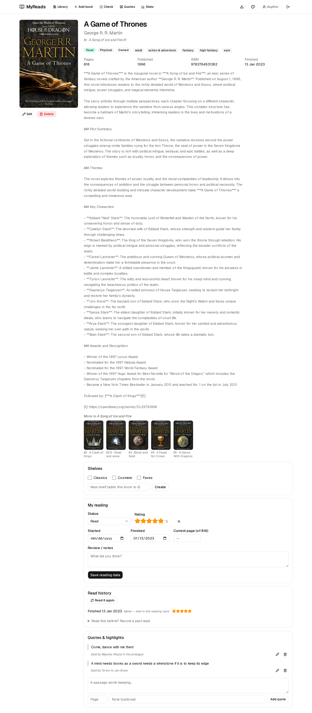

**Adding a book**: search by title, author or ISBN, or scan the barcode, then
pick a result to fill in the form.

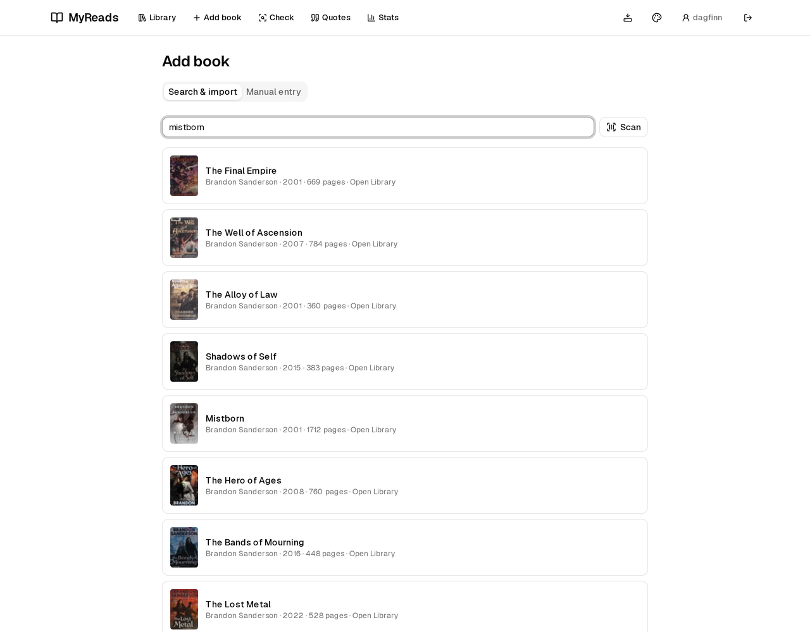

**Cover picker**: covers from all sources, with exact matches for your
edition first.

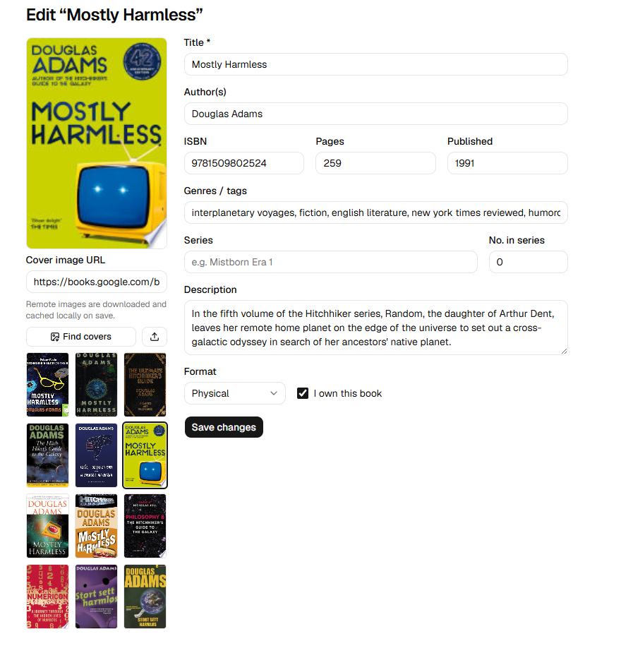

**Grouped by series**, in reading order:

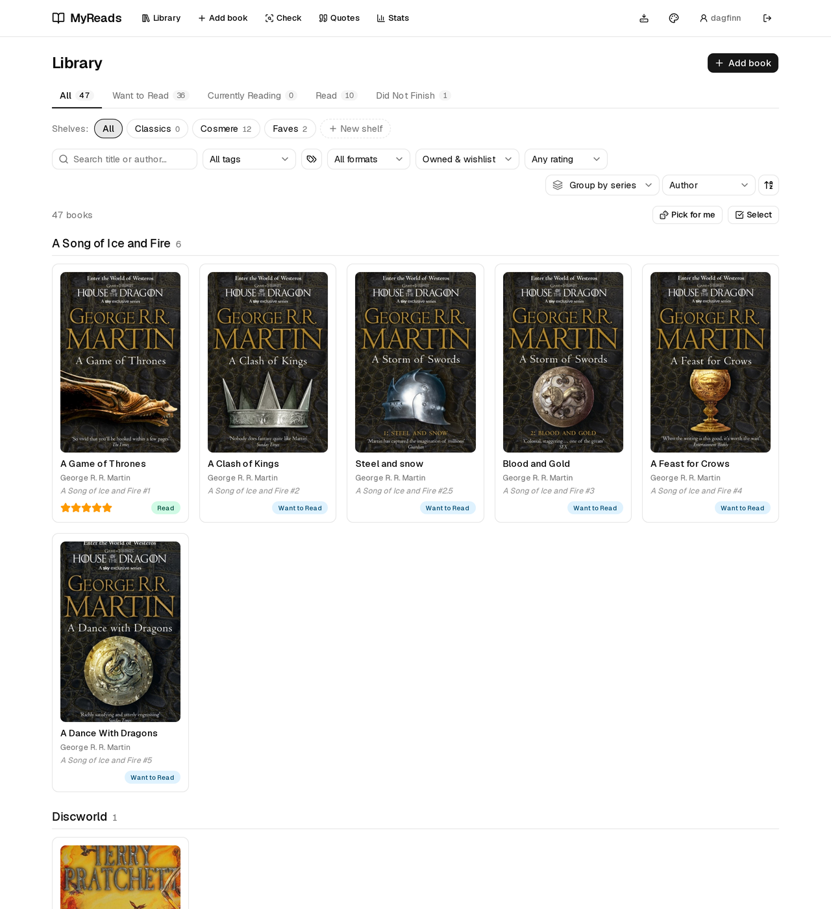

**Stats and reading goals**:

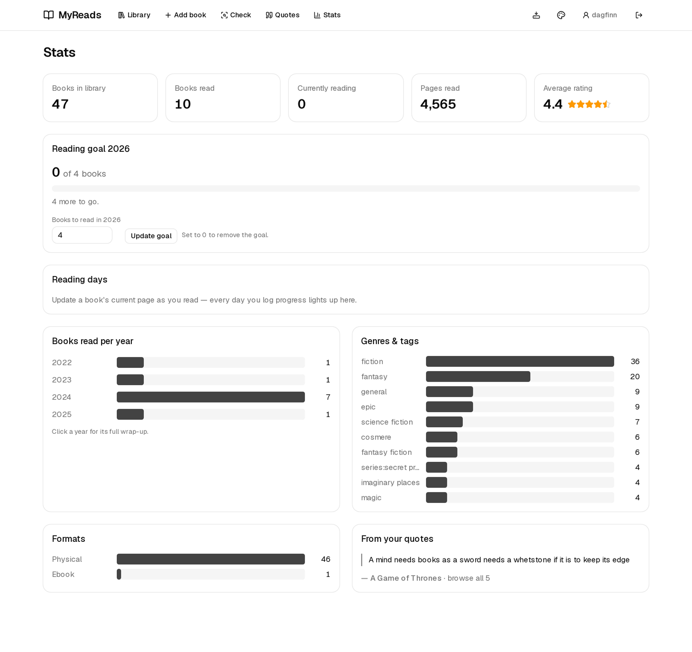

**Year in review**:

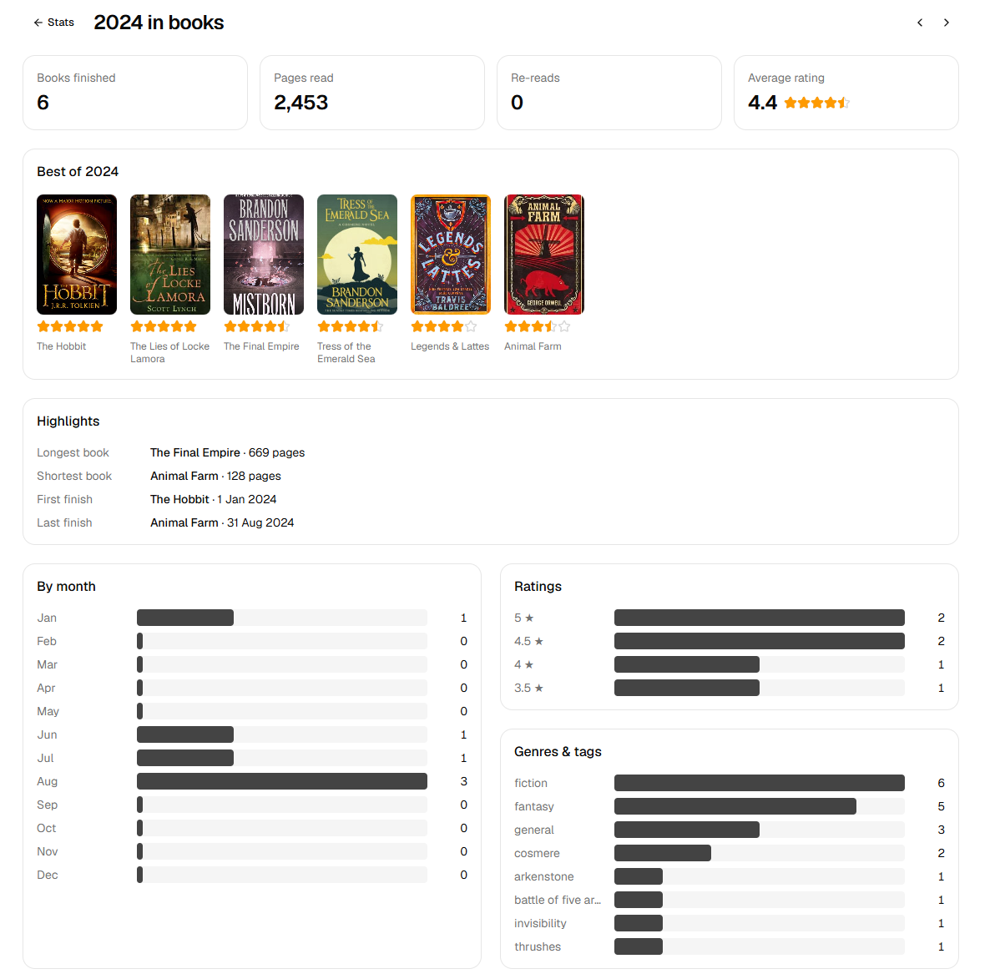

**Reading room**: the library as a house, by day and by lamplight.

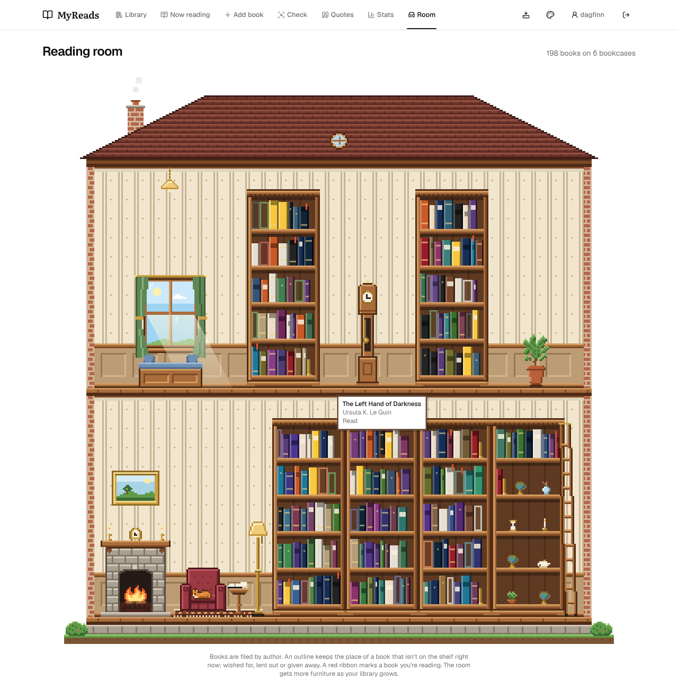

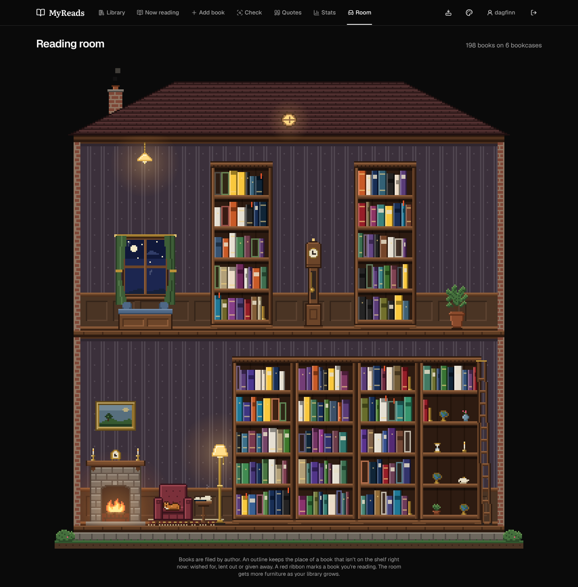

**Themes**: a dark theme, and the theme picker.

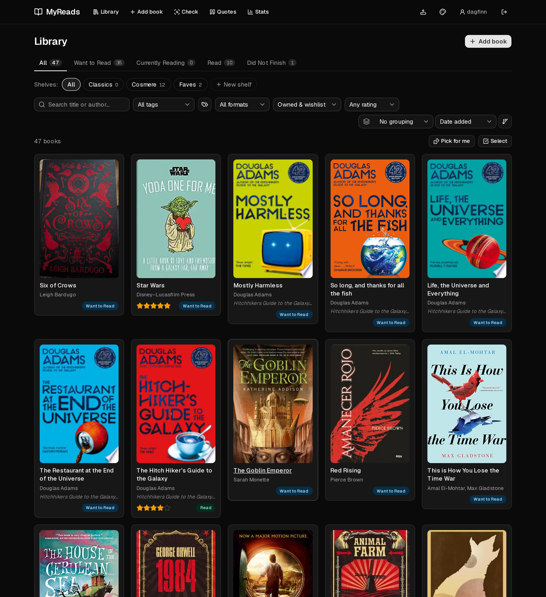

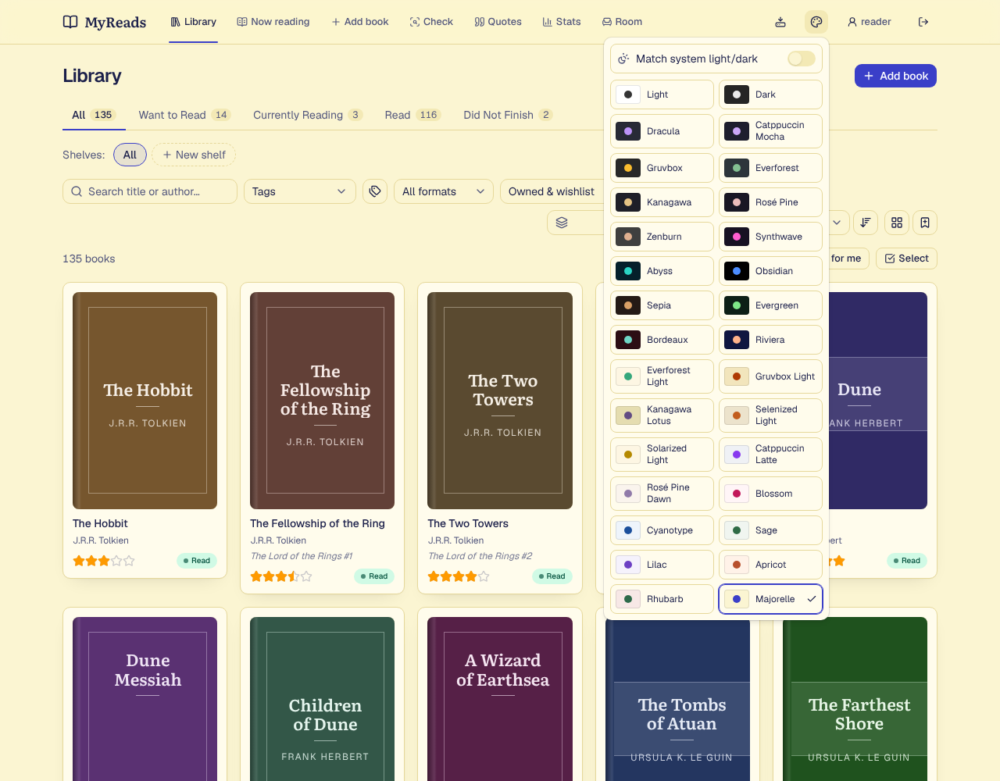

</details>

## Install

You need [Docker](https://docs.docker.com/get-docker/) with Docker Compose.

1. Get the code and make a settings file:

   ```bash
   git clone https://github.com/dagfinn2000/MyReads.git
   cd MyReads
   cp .env.example .env
   ```

2. Open `.env` and change two values:
   - `POSTGRES_PASSWORD`: any long random string.
   - `AUTH_SECRET`: paste the output of `openssl rand -base64 32`.

3. Start MyReads:

   ```bash
   docker compose up -d
   ```

4. Open <http://localhost:3000>, register an account, and add your first
   book.

The first start builds the app, so it takes a while. The database is set up
automatically.

## After installing

- **Close registration.** Once you have your account, set
  `DISABLE_REGISTRATION=true` in `.env` and run `docker compose up -d` again
  so nobody else can sign up.
- **Use HTTPS for the phone features.** Browsers only allow the barcode
  camera and installing the app on HTTPS or `localhost`, so on a plain
  `http://192.168.x.x` address they won't work. Put MyReads behind a reverse
  proxy with HTTPS (for example Caddy, nginx or Traefik). Barcode scanning
  works in Chrome and Edge, including Chrome on Android. With nginx, add
  `client_max_body_size 200m;` too: nginx turns away uploads over 1 MB by
  default, which stops most backups from being restored.
- **Make backups.** On the Account page, **Download backup** saves
  everything as a zip. **Restore backup** on the same page loads one into any
  MyReads server. Books you already have are skipped, so restoring twice is
  safe. The Backup card shows when you last downloaded one, and its
  **Remind me to back up** setting (not in Preferences) can put a note on
  the Library and Stats pages once a month.
- **Know where your data is.** The library lives in two Docker volumes:
  `pgdata` (the database) and `covers` (cover images).
- **Update.** Run `git pull`, then `docker compose up -d --build`. Database
  changes are applied automatically when the app starts.

## Server settings

These are the settings in `.env` you are most likely to change. The rest are
explained in [.env.example](.env.example). Personal choices are made in the
app instead: date formats, time zone and the rest under Preferences on the
Account page, and the theme with the palette button in the top bar.

| Setting | Needed? | What it does |
| --- | --- | --- |
| `POSTGRES_PASSWORD` | **yes** | Password for the database. |
| `AUTH_SECRET` | **yes** | Secret that signs logins. Make one with `openssl rand -base64 32`. |
| `DISABLE_REGISTRATION` | no | `true` stops new accounts from being created. |
| `GOOGLE_BOOKS_API_KEY` | no | Adds Google Books to search, which often has better descriptions and page counts. |
| `APP_PORT` | no | Port MyReads runs on (default `3000`). |

## Cleaning up cover images

Cover images that no book uses any more, for example from an upload you
never saved, stay on disk. To see how many there are, then delete them:

```bash
docker compose exec app node scripts/prune-covers.mjs        # report only
docker compose exec app node scripts/prune-covers.mjs --yes  # delete
```

Files less than a day old are always kept. Old search results are cleaned up
automatically every time the app starts.

## Development

MyReads is a [Next.js](https://nextjs.org/) app with PostgreSQL and
[Prisma](https://www.prisma.io/). To run it without Docker you need Node 22+
and a Postgres database. See [docs/DEVELOPMENT.md](docs/DEVELOPMENT.md) for
setup, tests, the project layout and the main design decisions.

## License

[MIT](LICENSE)
