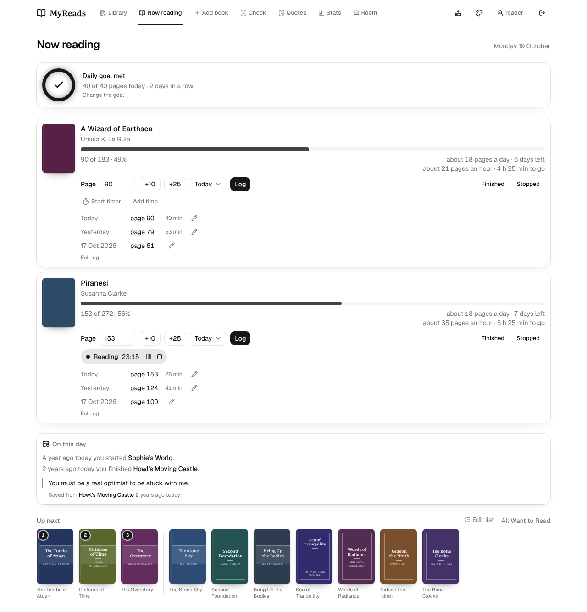

# MyReads

Personal self-hosted library and reading tracker. Keep track of the books
you own, what you're reading, and what you thought of them, on your own
server.


## What it does

**Add books**

- Search by title, author or ISBN in [Open Library](https://openlibrary.org/),
  [Google Books](https://developers.google.com/books) (optional) and the
  [National Library of Norway](https://api.nb.no/), check the details, and
  save. Or type a book in by hand.
- Scan the barcode with your phone's camera (in Chrome or Edge), one book
  at a time or a whole shelf in a row.
- **Do I own this?** In a bookshop, scan a barcode to see whether the book
  is already in your library.

**Track your reading**

- Status, ratings, notes, start and finish dates, and re-reads. Rename
  the statuses, or add your own, such as Paused.
- Log the page you're on and see your pace and when you'll finish.
  Ebooks can also go by percent, and audiobooks by time listened.
- Time your reading, set a daily goal in pages or minutes, get a reminder
  at a time you choose, and keep your own list of what to read next.
- Save quotes, or import your Kindle highlights.

**Organise your library**

- Shelves, tags, series in reading order, formats, what you own or wish
  for, and which books you've lent to whom and when they're due back.
- Fields of your own, such as where a book lives or what it cost.
- A Series page with how far you are in each series and what's next.
- Search, filter, sort and group, and save the views you use often.
- Show the library as cards, covers, a bookshelf or a list, and edit many
  books at once.

**See your stats**

- Books and pages per year, ratings, genres, a calendar of the days you
  read, and your reading habits.
- Goals for the year or every month, in books, pages or days you read,
  and challenges such as "6 classics in 2026".
- A year in review for every year.

**The reading room**

- Your library drawn as a pixel-art house, with every book a spine on a
  shelf. The house grows as your library does.
- Decorate it: thirteen house styles, colours, furniture, more rooms, a
  garden, the seasons and holiday decorations.
- Make a little you who lives there and sits down to read the book you're
  reading. Or turn the room off.

**Make it yours**

- 59 colour themes, a few with a picture, outlines or a font of their
  own, and twelve that restyle the whole app (Desktop 95 turns it into a
  1995 desktop, Aero into Windows 7's glass, Golden Gate into macOS's
  Liquid Glass, and KDE Plasma, GNOME and Hyprland into the Linux
  desktops). 26 background textures. On some of the textures rain falls,
  snow drifts or stars twinkle.
- A theme for one device or one part of the app, and your own CSS.
- Preferences for date formats, time zone, sorting, fonts and much more.
  Your settings follow you to every device.
- The top bar in your own order, keyboard shortcuts, and sounds if you
  want them.
- Install it on your phone's home screen like an app.

**Keep it safe**

- Download everything as one zip, covers and settings included, and
  restore it on any MyReads server.
- With Docker, the server also saves a copy of every library each night.

Every feature is described in [docs/FEATURES.md](docs/FEATURES.md).

Left out on purpose: anything social, recommendations of books you don't
have, and importing a list of books from a spreadsheet (CSV) file.

## Screenshots

<details>
<summary>Show screenshots: book page, Now reading, adding a book, cover picker, series, stats, year in review, reading room, themes</summary>

**Book page**: details, the rest of the series, shelves, and your own
reading data.


**Now reading**: the daily goal, a reading timer, the reading log, On this
day and Up next.



**Adding a book**: search by title, author or ISBN, or scan the barcode, then
pick a result to fill in the form.


**Cover picker**: covers from all sources, with exact matches for your
edition first.


**Grouped by series**, in reading order:


**Stats and reading goals**:


**Year in review**:


**Reading room**: a cottage in autumn by day, and a castle in winter by
lamplight, each with a room added upstairs.


**Themes**: a dark theme, and the theme picker (here on Macaron).


</details>

## Install

You need [Docker](https://docs.docker.com/get-docker/) with Docker Compose.

1. Get the code and make a settings file:

   ```bash
   git clone https://github.com/dagfinn2000/MyReads.git
   cd MyReads
   cp .env.example .env
   ```

2. Open `.env` and change two values:
   - `POSTGRES_PASSWORD`: any long random string.
   - `AUTH_SECRET`: paste the output of `openssl rand -base64 32`.

3. Start MyReads:

   ```bash
   docker compose up -d
   ```

4. Open <http://localhost:3000>, register an account, and add your first
   book.

The first start builds the app, so it takes a while. The database is set up
automatically.

## After installing

- **Close registration.** Once you have your account, set
  `DISABLE_REGISTRATION=true` in `.env` and run `docker compose up -d` again
  so nobody else can sign up.
- **Use HTTPS for the phone features and reminders.** Browsers only allow
  the barcode camera, reading reminders and installing the app over HTTPS
  or on `localhost`, so they won't work on a plain `http://192.168.x.x`
  address. Put MyReads behind a reverse proxy that adds HTTPS, such as
  Caddy, nginx or Traefik. The barcode camera also needs Chrome or Edge
  (Chrome on Android works). In other browsers, type the ISBN instead.
- **If you use nginx, let it accept big uploads.** nginx refuses uploads
  over 1 MB unless you change it, which stops most backups from being
  restored and most phone photos from being uploaded as covers. Add
  `client_max_body_size 200m;` to its settings for MyReads.
- **Keep a backup somewhere else.** On the Account page, **Download
  backup** saves everything as one zip, and **Restore backup** loads it
  into any MyReads server. The server's own nightly copies sit on the same
  machine as your library, so download one now and then and keep it
  elsewhere. More in [Backups](docs/FEATURES.md#backups).
- **Know where your data is.** It lives in three Docker volumes: `pgdata`
  (the database), `covers` (cover images) and `backups` (the nightly
  copies).
- **Update.** Run `git pull`, then `docker compose up -d --build`. Database
  changes are applied automatically when the app starts. What changed in
  each version is on the
  [Releases](https://github.com/dagfinn2000/MyReads/releases) page.

## Server settings

These are the settings in `.env` you are most likely to change. The rest are
explained in [.env.example](.env.example). Personal choices are made in the
app instead: date formats, time zone and the rest under Preferences on the
Account page, and the theme with the palette button in the top bar.

| Setting | Needed? | What it does |
| --- | --- | --- |
| `POSTGRES_PASSWORD` | **yes** | Password for the database. |
| `AUTH_SECRET` | **yes** | Secret that signs logins. Make one with `openssl rand -base64 32`. |
| `DISABLE_REGISTRATION` | no | `true` stops new accounts from being created. |
| `GOOGLE_BOOKS_API_KEY` | no | Adds Google Books to search, which often has better descriptions and page counts. |
| `APP_PORT` | no | Port MyReads runs on (default `3000`). |
| `BACKUP_HOUR`, `BACKUP_KEEP` | no | Every night the server saves a backup of each account in the `backups` volume: at this hour (UTC, default `3`), keeping the newest `7`. |
| `READING_REMINDERS` | no | `off` stops the server sending reading reminders. They are on by default and need no setup, but browsers only allow them over https. |

## Cleaning up cover images

Cover images that no book uses any more, for example from an upload you
never saved, stay on disk. To see how many there are, then delete them:

```bash
docker compose exec app node scripts/prune-covers.mjs        # report only
docker compose exec app node scripts/prune-covers.mjs --yes  # delete
```

Files less than a day old are always kept. Old search results are cleaned up
automatically every time the app starts.

## Development

MyReads is a [Next.js](https://nextjs.org/) app with PostgreSQL and
[Prisma](https://www.prisma.io/). To run it without Docker you need Node 22.13
or newer and a Postgres database. See [docs/DEVELOPMENT.md](docs/DEVELOPMENT.md) for
setup, tests, the project layout and the main design decisions.

## License

[MIT](LICENSE)
