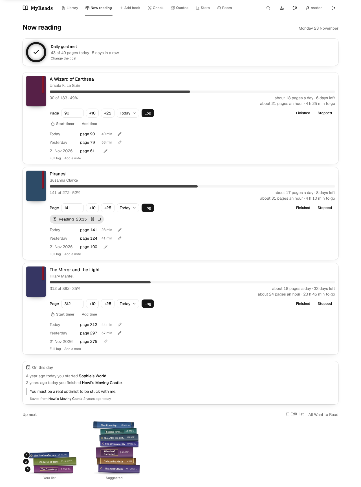
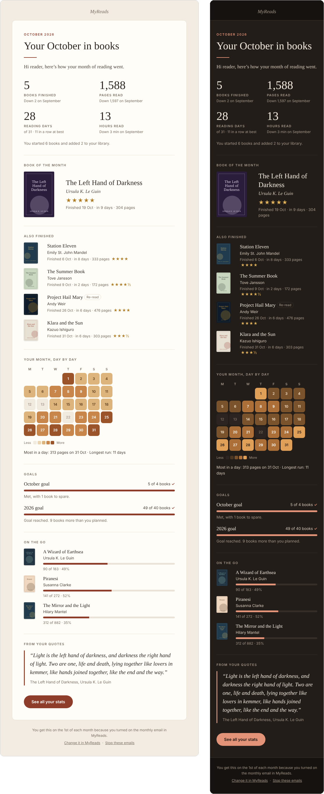

# Everything MyReads can do

The [README](../README.md) has the short version. This is the full list,
page by page.

- [Adding books](#adding-books)
- [Reading](#reading)
- [Notes and quotes](#notes-and-quotes)
- [The library](#the-library)
- [Stats](#stats)
- [The reading room](#the-reading-room)
- [Look and feel](#look-and-feel)
- [Preferences](#preferences)
- [Signing in](#signing-in)
- [Backups](#backups)

## Adding books

- A new, empty library opens with a welcome and three ways to start: add
  books (a whole shelf by barcode, if you like), restore a backup from
  another MyReads server, or pick a theme.
- Search by title, author or ISBN and import the details from
  [Open Library](https://openlibrary.org/), with
  [Google Books](https://developers.google.com/books) (optional) and the
  [National Library of Norway](https://api.nb.no/) as extra sources. You
  choose which of them to search and in what order. Check and edit
  everything before saving, or type a book in by hand.
- Scan the barcode on a book with your phone's camera. Switch on Keep
  scanning to work through a whole shelf: each book is looked up and added
  as you scan it, with Undo, and books you already have are pointed out.
- "Add and add another" brings you straight back for the next book (with
  the camera open again if you scanned). In Preferences you choose what
  adding a book does: open it, add another, or go to the library.
- A book added as Read can say when you finished it, or that you don't
  remember, so years of old reading don't land in this year's stats. A book
  added as Currently Reading can say when you started and what page you're
  on.
- Subjects from the catalogues can be copied in as tags: all of them, only
  the tags you already use, or none. Renaming or removing a tag in Manage
  tags can apply to future imports too.
- "Look up details" on a book's edit page fills in what's missing, like a
  page count, from the catalogues.
- Choose a cover from the search results, paste an image link, or upload a
  photo. Covers are stored on your server.
- **Do I own this?** In a bookshop, scan a barcode on the Check page to see
  whether the book is already in your library.

## Reading

### Statuses and ratings

- Each book has a status (Want to Read, Currently Reading, Read, Did Not
  Finish), a rating, notes, and start and finish dates. Rate in half
  stars, whole stars or out of 10, or switch ratings off.
- **Plot, characters and writing:** under a book's rating, open "Plot,
  characters and writing" to rate each one on its own. Each is optional,
  and your overall rating stays your own, not their average. Switch them
  off in Preferences if you don't want them.
- Rename the four statuses, or add up to 12 of your own, each a kind of
  one of them: "Paused" under Currently Reading, say, or "On my shelf"
  under Want to Read. Each has its own colour, shows in every status
  menu and on the book's badge, and gets its own chip under its tab in
  the library. Stats, goals and challenges count a book on one of your
  own as the status it is a kind of. No two statuses can share a name.
- **Why you stopped:** after Stopped on Now reading, one tap says why
  (too slow, not for me, didn't like the writing, lost interest, too long,
  not the right time, or something else). It's optional, and a stopped
  book's page has the same menu. Picking the book up again forgets it.
- Re-reads are kept as history and count in your stats.

### Logging your reading

- **Now reading** lists the books you're reading. Log the page you're on,
  for today or an earlier day. Each book shows your pace and when you're
  likely to finish. A book you haven't logged for two weeks says when
  you last read it.
- **Finish by:** give a book a day to have it read by, a book club's
  meeting or a library's due date, on its reading card. The book then
  says how much a day it takes from today (in pages, percent or time),
  turns green when your pace gets there and amber when it doesn't, and
  red once the day has passed. Books still to start whose day is two
  weeks off or less show under To start soon on Now reading, and the
  library marks them with the day. Finishing or putting a book down
  clears its day.
- In Preferences you can log ebooks in percent, and audiobooks in percent
  or in hours and minutes listened. Percent needs the book's page count,
  and time needs the audiobook's length too. Both go on the book's Edit
  page.

### Without a connection

- **Log reading offline.** On a train or a plane, the log on Now reading
  and on a book's page still works. The page you log, and the time from
  the reading timer, are saved on your phone or computer, the book's bar
  moves, and the book lists what's waiting. Finished and Stopped work
  too, with Undo. Once MyReads can be reached again, it all goes by
  itself, dated when you logged it, so it counts for the right day.
- **The app opens offline.** Pages you've opened lately open without a
  connection, and Now reading always does. They show what they had when
  you last opened them. A page that wasn't saved lists the ones that
  were.
- The top bar says when you're offline, and how many logs are waiting.
  Tap it to see them, or to send them now.
- If a log can't be saved when it's sent (the book was finished on
  another device meanwhile, say), the top bar says so and why, and you
  can remove it.
- Opening pages offline needs MyReads over https, or on `localhost`. On a
  plain http address the pages don't open offline, but a log you make
  when the wifi drops still waits and goes later.
- Signing out takes the saved pages off the device.

### Timer, daily goal and reminders

- **Reading timer.** Press Start timer when you sit down with a book, and
  the time goes with the next page you log (or type the minutes in). Once
  a book has some timed reading, it shows how many pages you read an hour
  and how long the rest will take, and Stats adds up your time read. The
  timer keeps going if you close the page or lock your phone, in the
  browser you started it in.
- **Daily goal.** Set one in pages or minutes in Preferences > Reading,
  and a ring on Now reading fills as you read through the day, with a
  little celebration when you reach it. Minutes come from the reading timer
  or the time you type in. The ring counts the days in a row you've met
  the goal, and the Reading days calendar on Stats says how many days you
  met it in the last year.
- **Reading reminders.** A notification on your phone or computer at the
  time you choose, on the days you choose, naming the book you read last
  and what's left of your daily goal. By default none comes on a day
  you've already read. Turn them on in each browser you want them in
  under Preferences > Reading reminders, which lists them all with a
  Test button. They need MyReads opened over https, and on an iPhone or
  iPad, MyReads added to the Home Screen.

### Up next and On this day

- **Up next.** Add Want to Read books to your own list, from their page or
  from Now reading, and put them in order. They come first in Up next on
  Now reading, before the suggestions (the next book of a series you're
  reading, then the books you added last). Starting or finishing a book
  takes it off, and you can take one off yourself on its page or in Edit
  list.
- Up next shows as books piled on a table, spines out and never quite
  straight: your list on one pile with the next to read on top, and the
  suggestions on another. The books drop onto the piles one by one as they
  come into view, wobbling as they land, and when you put your list in
  another order the pile restacks as Edit list closes, a book going up
  pulled out to the side and put back on. Preferences > Appearance can
  show a row of covers instead.
- **On this day.** Now reading remembers what you finished or started on
  today's date in earlier years, and a quote you saved on it.

## Notes and quotes

- **Notes while you read.** Each book's page has a Notes & quotes card.
  Write a note (a thought, a question, a guess at what happens next) or
  save a quote, and give it a page, a chapter, both or neither. While
  you're reading a book the page box starts at the page you're on, and
  "Add a note" on Now reading takes you straight there.
- **In the order of the book.** Notes and quotes line up by page, under
  the chapters you named. "3", "Ch. 3" and "Chapter 3" count as the same
  chapter, and the chapter box suggests the ones the book already has. A
  note with a chapter but no page goes at the end of that chapter, and
  ones with no page at all come last. All, Notes and Quotes buttons show
  one kind at a time.
- **A strip of the book.** Above the list, a bar runs from the first page
  to the last, with a dot for each note, a bookmark for each quote,
  chapters shaded in turn, and an arrow at the page you're on. Point at a
  mark to read it; click it to jump to it in the list.
- Search all your quotes on the Quotes page, by their text, your note on
  them, their chapter or the book.
- **Take them to your notes app.** The download button on a book's Notes &
  quotes card saves them as a Markdown file, in the order of the book under
  its chapters, with your review and the book's details (author, dates,
  rating, tags) at the top the way Obsidian reads them. On the Quotes page,
  Download as Markdown saves a zip with one such file for every book that
  has notes or quotes. Everything goes out exactly as you typed it.
- **Quote pictures.** The picture button by a quote sets it large with the
  book's title and author under it, to download or, on a phone, share
  straight to another app. Four looks (Paper, Night, the cover's colours
  with the cover beside the title, or typed on an index card) and two
  shapes, square or tall for a story. It's made on your device, and the
  look you chose last is ready next time.
- **Import from Kindle.** On the Quotes page, bring in your highlights.
  Connect your Kindle to a computer and pick `My Clippings.txt` from its
  documents folder. Before anything is saved, you check which book in
  your library each Kindle book's highlights go into. Notes you made on
  the Kindle come along too, and importing the same file again only adds
  new ones. The file stays on your device: only the highlights you import
  are saved.

## The library

- Custom shelves, tags, series in reading order, format (physical, ebook,
  audiobook) and ownership (owned, wishlist, borrowed from someone, no
  longer have it).
- **Smart shelves** fill themselves. Make one with New shelf > Smart
  shelf, then pick its rules with the library's tabs, shelves and filters,
  for example Want to Read, tagged sci-fi, up to 300 pages. The books
  below the filters are the ones it will hold. After that, every book that
  matches is on it, and a book joins or leaves by itself when you change
  it. You can also turn the filters you have on into a smart shelf from the
  Save button by the search box.
  - It sits with your other shelves, marked with sparkles, and shows how
    many books it holds. Open it and its rules show under the shelves; the
    pencil on its chip, or Change rules, lets you change them.
  - A book's Shelves card lists the smart shelves it's on. Group by shelf,
    challenges and backups include them. Manage shelves renames, reorders,
    hides and deletes them. Deleting one never changes a book.
- **Your own fields.** Add up to 20 fields of your own to every book:
  text, a number, a date, yes or no, or a choice from your own list
  ("Where it lives", "Price paid", "Signed", "Edition"). Fill them in on
  the add and edit forms; they show with the book's details on its page.
  The library's search finds text and choices, and More filters finds
  books with or without a value, with a given choice or yes/no, or with a
  number or date in a range.
- **Moods.** Say how a book feels with "Add moods" under its title: cosy,
  funny, light-hearted, romantic, hopeful, whimsical, inspiring,
  adventurous, thoughtful, informative, challenging, emotional, sad,
  mysterious, tense, spooky or dark, each with its own icon and colour.
  Then find a book for your mood with the library's Moods filter: any or
  all of the moods you tick, leaving out the ones you switch to Not. You
  can also group the library by mood, and a mood on a book's page links
  to every book that has it. Preferences can hide moods you never use, or
  add up to 16 of your own.
- Keep track of the books you've lent out, who has them and since when,
  on each book's Lending card. Give a loan a day it's due back (Preferences
  can fill one in, say a month after you lend it). Past that day the book
  turns red, shows under the Overdue filter, and a note on the Library and
  Now reading pages reminds you who has it.
- Mark a book as Borrowed and say who it's from (the library, a friend).
  Its page says "Borrowed from …", and its Finish by day reads as the
  day it's due back.
- **Quick find:** press Ctrl+K (⌘K on a Mac) on any page, or the
  magnifier in the top bar, and type a few letters. Books, authors,
  series, shelves and pages that match show as you type: arrow keys and
  Enter open one (Ctrl+Enter in a new tab), and the last line searches
  the whole library. With nothing typed it lists the books you're
  reading and every page. When no title matches, the author or series
  comes first, so "le guin" lands on Ursula K. Le Guin.
- **Tidy up** (beside Add book in the library) lists the books that could
  use a little care: ones that look like the same book twice (the same
  ISBN, or the same title by the same writer), books on Currently Reading
  with nothing logged for two months, missing covers, page counts and
  authors, and reads without a finish date. Put a forgotten book down or
  back on the pile from there, or leave anything alone and it stops
  showing. **Fill from the catalogues** looks up every book with an ISBN
  and fills in its cover and page count where they're missing, never
  replacing what you set.
- Search, filter, sort and group the library. Authors sort by surname, the
  way a bookshelf is filed.
- **Rainbow shelf.** Sort by Cover colour and the library runs like a
  rainbow: red, orange, yellow, green, blue, violet and pink, each colour
  light to dark, then the white, grey and black covers. It's lovely in the
  Spines view, and handy when all you remember is that the book was blue.
  Each cover's colour is read once on your server, the same way the spines
  get theirs (a library with many covers may take a moment the first
  time). A book without a cover goes by the colour its cover is drawn in. More filters also finds books by page count
  ("up to 300 pages"), the year they came out, and when you added them
  (in the last week, month, three months or year).
- **More like this:** at the foot of a book's page, up to eight books from
  your own shelves that share its genres and tags, moods or author, each
  saying what it shares. A tag few of your books have counts for more than
  one most of them have, books still to read come first (marked To read),
  books you put down stay out, and a series shows one of its books. Hide
  or move the card in Preferences, like the page's other cards.
- **The Series page** shows every series you have, the series you're in
  the middle of first: how much of each you've read, which book is next,
  and an empty place for each number you have no book for. Open it from a
  series heading in the library or "What's next in the series" on a
  book's page, or put it in the top bar from Preferences.
- **The Authors page** lists every author in your library, the ones you've
  read most first: how many of their books you've read, a cover for each
  in the order you read them (then the ones still waiting), the rating you
  give them on average, the pages you've read of theirs, when you read
  them, and which of their books to read next (your Up next list first,
  then the next in a series of theirs, then the one that has waited
  longest). Order them A to Z, by your ratings or by what you read lately;
  show only the authors with books waiting, or the ones you haven't read
  yet; or find one by name. An author heading in the library (group by
  author) opens their card, and their name on the card shows all their
  books in the library. Put Authors in the top bar from Preferences (then
  `g` and `a` opens it too).
- "Pick for me" opens a random book from the ones on screen, keeping to
  your filters. On the All tab it picks from Want to Read first. In
  Preferences you can have it pick only books you have, or only the next
  book in a series.
- Show the library as cards, bare covers or a bookshelf, in three sizes, or
  as a list, and choose what each book shows. Covers can look like little
  hardbacks, and books without a cover get one drawn with their title.
- **Clothbound covers.** In Preferences > Appearance, books without a cover
  can be bound in cloth instead: the drawn cover's colour, woven, with the
  groove where the board meets the spine, the title stamped in gilt inside
  a double gilt frame, or on a dark label across the middle. The light runs
  along the gilt when you point at a cover. Grey and green themes
  (E-Paper, Bitmap, Dot Matrix) stamp it in silver or pale green.
- **Bookmark ribbons.** A book you're reading has a satin ribbon hanging
  from the top of its cover, down as far as you've got: a short tail at
  the start, the foot of the cover at the end. Point at it for the page.
  Preferences > Appearance picks crimson, navy, green or gold, or the plain
  bar under the cover instead.
- **Shelf wear.** Books show how they've been treated. One nobody has
  touched for a year or more (started, logged or finished; for a book on
  the pile, since it was added) gathers a faint film of dust, a little more
  at two years and four. A favourite, read again and again or rated 4½
  stars or more, looks well worn: creases down the hinge, the colour rubbed
  off its corners, a corner once folded back. In the Spines view the dust
  lies along the tops of the books and favourites have cracked spines.
  Point at a cover to see why. Preferences > Appearance can keep every
  book like new.
- **Dog-eared corners.** A book you stopped reading has its top corner
  folded down, to keep your place for another go: the flap of the cover
  lies across it with its pale inside up, the first page shows in the
  corner, and pointing at it says the page you stopped at. With animations
  on the flap lifts a little under the pointer. Preferences > Appearance
  can leave the corners flat.
- **Bookplates.** A printed book you own has an "Ex libris" plate under
  its cover, as if pasted inside it: a small framed label with an open
  book, your name in italics and the book's number in your library
  (counting in the order you added them) with the year it came in. It's
  printed in the theme's own colours on a cream paper, in the same face
  whatever the page is set in, and closes the page on a phone.
  Preferences > Appearance can give it another name than your username,
  or leave it off.
- **Shadows under covers.** Every cover sits on a thin, even shadow with a
  hairline edge, so a pale cover doesn't melt into a pale page, and one
  you can open lifts a little under the pointer as its shadow softens
  below it. Themes with a flat look of their own (Terminal, Blueprint,
  Desktop 95, the pixel and print themes) keep their covers flat.
  Preferences > Appearance can lay every cover flat on the page.
- **Stickers on covers.** Pin stickers and stamps on a book's cover from
  its page (the Stickers button under the cover): Signed, First edition, A
  gift, Re-read, Loved, Book club, Award winner, Bargain, Rare and Holiday
  read. Each goes on a little crooked, the same way every time, and in the
  order you pinned them: the library shows the first two on small covers
  and up to four on big ones, on cards, bare covers and the bookshelf.
  They go into backups with the book.
- **Covers that follow the pointer.** With a mouse or trackpad, a cover in
  the library or on a book's page leans back where the pointer rests on
  it, as if pressed, and catches a soft light under the pointer, then eases
  back flat when you move away. It can be turned off in Preferences >
  Motion.
- **Spines.** Or stand the books spine out in a bookcase, coloured from
  their covers, with the title running down each spine and the author's
  surname at the foot. Thick books are wider, heights and bindings vary
  (gilt bands, a label, leather, plain cloth), the ribbon peeks out of the
  books you're reading, and books on your wishlist, lent out or given away
  keep their place as an outline. Point at a spine and it slides out a
  little.
- A book you're reading is in its full colour only as far up its spine as
  you've read, and pale grey above, like a glass filling up; as the
  library opens, the colour rises to the mark. Preferences > Appearance
  can keep every spine in full colour.
- Save the searches and filters you use often as views, and open the
  library on one of them if you like. A view keeps the sort and grouping
  too; a smart shelf keeps only which books.
- A book opened from the library has an X in its corner (or press Esc)
  that takes you back to the same spot in the library, with your filters
  still on.
- Edit many books at once: set their status, format or ownership, add or
  remove tags or a mood, put them on a shelf or take them off it, or
  delete them.
  Pick the books on screen, or every book that matches your filters.
- **Recently deleted.** A book you delete, one at a time or many at once,
  waits in Recently deleted for 30 days with its reading history, notes,
  quotes and loans. Right after a delete the library offers Undo. Later,
  open Recently deleted from the line under the library (or with quick
  find) and press Put back: the book returns just as it was, on the same
  shelves. Delete now, or Empty, removes books for good straight away.
  Books in it aren't part of a backup.
- Rename, merge, reorder and hide shelves, and choose which status tabs the
  library shows. Saved views can be renamed and reordered too.

## Stats

- Books read per year, pages read, ratings, genres and formats. Look at
  all time, this year, the last 12 months or the last 30 days.
- **Moods:** once your books have moods, a card shows the ones you read
  most, each linking to its books in the library.
- **Reading days:** a calendar with a square for every day, darker the
  more you read. It shows the last 12 months or any year you read in, and
  can go by pages or, with the timer, by time. Above it are your current
  and longest streaks: point at one (or tap it) and its days light up.
  Tap a day to see the books you read that day.
- **This year against last:** books, pages, reading days, time and your
  average rating so far this year beside last year by the same day, with
  how many books this year's pace comes to. Below them, both years' books
  as two lines through the year; point at a day for both counts.
- **Reading habits:** which days of the week you read most, pages on an
  average reading day, how long a book takes you from start to finish, and
  with the timer your average sitting and pages an hour.
- **Your to-read pile:** how many books wait on Want to Read, a small line
  of the pile over the last twelve months, how many you added and started
  in that time, and how long the pile lasts at your pace. Bars show how
  long the books have waited, beside the three that have waited longest.
- **Why you stopped:** once you've put a book down, the reasons you gave,
  how far in books get put down, the genres you put down most, and the
  books you stopped because it wasn't the right time.
- **Ratings:** how many books got each rating, the rating you give most,
  and your average for plot, characters and writing with the book you
  rated best for each. Once enough books are rated, it also says which of
  the three your overall rating follows most. The year in review shows the
  three averages too.
- **Numbers written in ink:** as Stats opens, its big numbers write
  themselves in from the left like ink from a pen, a stroke at a time, the
  ones side by side one after another. Numbers further down wait until you
  scroll to them. Preferences > Stats page can have them simply show, as
  they do with animations off.
- Decide what counts in your stats. Pages read can mean a whole book's
  pages when you finish it, or the pages you log as you go. You also
  choose whether books you stop reading count, and how audiobooks count.
- A "year in review" page for every year. It opens with the year on a
  shelf: every book you finished standing spine out in the order you
  finished it, coloured from its cover, with a little brass plate on the
  shelf where each month begins.
- **Play your year:** the button at the top of a year in review plays the
  year back as a story, one highlight to a screen: books, pages, hours
  with the timer, the days you read with your longest streak marked on a
  calendar, your busiest month, favourite genres, author of the year, top
  books (or the longest and quickest, with ratings off) and the goal if
  you reached it. Tap or click to go on, tap the left side to go back, and
  hold to pause. With animations on it moves along by itself; with them
  off it waits for you.
- It ends with a picture of the year to download or, on a phone, share:
  the year's figures, genres and author over a shelf of every book you
  finished. Three looks (Paper, Night, or your theme's colours and
  heading font) and two shapes, tall for a story or square. It's made on
  your device.
- Yearly reading goals in books, pages or days you read, with or without
  re-reads. The goal shows whether you're on track, and next year's can be
  set ahead of time.
- **Monthly goals:** a goal for every month of the year, such as 2 books or
  reading on 20 days. Twelve month cells show which months made it, and
  this month says how to catch up.
- **Challenges:** a goal for part of your library, such as "6 classics in
  2026". Make one from a tag, a mood, a shelf or a saved view; it shows
  the covers of the books that count so far, and a medal once it's done.

### Monthly email

An email on the morning of the 1st (08:00 where you are) with the month
before in books. It's off until you turn it on, under Preferences >
Monthly email, with the address it should go to.

- It has your books finished, pages, reading days and time read, each
  beside the month before; the best-rated book of the month large, with
  its cover, and the others you finished; a calendar of the month, darker
  the more you read; your monthly and yearly goals; what you're reading
  now; and a quote you saved that month. It counts the same way as Stats.
- **Preview** shows any of the last twelve months' emails, and **Send it
  to me** sends one to you now, to see it in your own mail app.
- A month with no reading gets no email, unless you turn that off.
- **Stop these emails** at the bottom turns it off without signing in.
- It looks right in light and dark mail apps, and on a phone.
- It needs a mail server, set up by whoever runs MyReads (`SMTP_HOST` and
  the settings beside it in [.env.example](../.env.example)). Without one,
  Preview still works.

## The reading room

The Room page draws your library as a cozy pixel-art house.

- Every book is a spine on a shelf, filed by author and coloured from its
  cover, with thick books on wide spines. Point at one to see its title,
  and click it to open the book. The book's X puts it back on its shelf.
- A ribbon marks the books you're reading. Books on your wishlist, lent
  out or given away keep their place as an outline.
- The house grows with your library: more bookcases, then more floors.
  Furniture moves in as you add books: a plant, a cat asleep in the
  armchair, a grandfather clock, a library ladder, a window seat, a
  writing desk and a gramophone.
- Light themes show it by day. Dark themes show it at night, with the
  lamps lit and the fire glowing. Either way the room takes on the light
  outside: rosy at sunrise, amber at sunset and dimmer after dark.
- While the reading timer runs, a candle burns on the table by the
  armchair, shorter every few minutes as you read: from a new candle to a
  stub over your daily goal when it's in minutes, otherwise over an hour.
  Wax runs down its side and pools in the dish as it goes, and at night it
  casts a little pool of light. Pause or stop the timer and it's snuffed
  out (with a wisp of smoke, if the room is open in another window); log
  the time and it's put away. Preferences > Reading room can leave it
  unlit.

Everything below is under **Decorate** on the Room page.

### The house

- Thirteen house styles, each with its own roof, walls, door and garden:
  a cottage, a castle (with a banner on the battlements), a wizard's
  house, an elven hall (fireflies among the birches at night), a cave in
  a hill, a space station (with a blinking beacon), a modern house, a log
  cabin, a tea house, a workshop (a gear turning on the gable), a
  lighthouse (its beam sweeping round at night), a windmill (its sails
  turning over the thatch) and an adobe house with cacti in the garden.
  Most have smoke rising from the chimney.
- The colour of the walls, the wood and the fabrics.
- Wallpaper (stripes, damask, flowers, trellis, stars, stone, tiles, Delft
  tiles, paper screens and more) and floors (boards, wide planks, parquet, flagstones,
  chequered tiles, carpet, tatami or a metal grate).
- Fairy lights, bunting, paper lanterns or ivy along the ceilings. At
  night the fairy lights twinkle.
- Windows (sash, arched, round, shuttered or leaded) wherever the wall
  above the furniture is clear, with the sky outside by day and the moon
  and stars at night.
- Pictures on the bare walls of every room, taking turns with the windows:
  paintings, portraits in oval frames (the cat of the house has one),
  botanical prints, maps and star charts, groups of old photographs, or a
  bit of each.

### By the fire

- The fireplace: stone, brick, marble, blue tiles, or modern, which burns
  along a bed of stones.
- The armchair: a wingback, club chair, Chesterfield, lounge chair or
  carved chair.
- The rug: fringed, Persian, braided, kilim, a sheepskin or none.
- The lamp: a standard lamp, a Tiffany lamp, an arc lamp, a candle stand
  or a paper lantern, all lit at night.
- Over the fireplace: a painting or one of five tapestries.
- The chair and the rug take the fabric colour.

### Bookcases

- Classic, open shelves with the wallpaper showing behind the books, a
  pediment, Gothic pinnacles, or a barrister's case with a glass door over
  each shelf.
- A few ornaments beside the books, plenty of them (a pile of books lying
  flat, a cactus in flower, a china bird, an inkwell and more), or none.

### Rooms and furniture

- Add rooms: a kitchen with the kettle on the range, a bedroom under a
  patchwork quilt, a music room, a conservatory with a songbird, a games
  room with a billiard table, a studio with an easel, a bathroom with a
  bubble bath, a dining room under a chandelier, a nursery with a mobile
  over the cot, a woodshop, a sauna with steam rising off the stove, or a
  spare room to fill yourself.
- Each room goes upstairs on a floor of its own, or next to the library
  (or the room before it) where the screen has space. The wall between
  has a door. When the room is on the same floor as the fireplace, the
  door opens as your little you walks through.
- Each added room can have its own wall colour, wallpaper and floor. The
  bathroom comes tiled and the sauna panelled in logs.
- Add furniture from a catalogue: a Chesterfield sofa, a rocking chair, an
  aquarium with fish swimming in it, a spaniel asleep in its basket, a suit
  of armour, a sea chest, a coat stand, a telescope, a rocking horse, a
  curio cabinet, a spinning wheel, a bean bag, a macaw on its perch, a
  monstera, a standing mirror, a wood stove, an old radio playing, a tea
  trolley and a dollhouse. Each goes wherever there's space.
- Press Move furniture, then drag a piece to where you like it, or select
  it and use the arrow keys. The bookcases stay in the order of your
  books. To put a piece away, untick it under Furniture in Decorate.

### Outside and the seasons

- Grow ivy, climbing roses or wisteria up the outside walls. Plant flower
  beds, bushes and trees round the house, and put up a picket fence if you
  like. (A cave is dug into its hill, so it has neither.)
- Pick the time of year, or follow the calendar (with northern seasons,
  so winter starts in December): blossom, tulips and
  daffodils in spring; gold and red leaves falling in autumn, with
  chrysanthemums in the beds and red ivy; in winter bare trees, snowdrops,
  snow on the roof and in the garden, icicles under the eaves and snow
  falling. The view from the windows changes with it.
- With Weather outside on (Preferences > Appearance), the real weather
  falls round the house too: rain in streaks, or snow, whatever the season.

### Holidays

- Decorate for Christmas, Halloween, Easter, Midsummer or New Year's Eve,
  all year round, or let "Follow the calendar" put each up in its own
  days: Christmas from 1 December to 6 January, Halloween from 24
  October, Easter from Palm Sunday to Easter Monday, Midsummer from 20 to
  24 June, and New Year's Eve and Day.
- **Christmas:** a tree with twinkling lights, a star, baubles and parcels
  beside the hearth, or on another floor with room (with no room
  anywhere, a little tree on the mantelpiece), a garland along the mantel,
  coloured lights along the eaves and a wreath on the doors between rooms.
- **Halloween:** carved pumpkins flickering on the mantel and by the
  house, and cobwebs in the corners of every room.
- **Easter:** birch twigs hung with eggs and feathers on the mantel, and
  painted eggs hidden in the grass.
- **Midsummer:** a garland of flowers along the eaves and a bonfire in the
  garden.
- **New Year's Eve:** streamers in every room and fireworks in the sky.

### Your avatar and pet

Make a little you who lives in the house. They potter about and stop by
the fire, and while you're reading a book they sit in the armchair reading
it (the cat moves to the rug). With animations off they stand still by the
fire.

- **Face:** ten skin tones (an elf or a spaceman too), eyes in seven
  colours, round or pointed ears, a mouth, blush, freckles or a beauty
  spot (or all three), and a beard.
- **Hair:** 23 hairstyles in 14 colours.
- **Body:** three heights, and four body shapes: slim, average, broad or
  round. Get about on foot, with a walking stick or in a wheelchair.
- **Clothes:** jumpers, T-shirts, shirts, cardigans, hoodies, a waistcoat,
  a long coat, a dress or a robe; trousers, jeans, shorts, skirts or
  dungarees, in colours of your choosing; and six kinds of shoes.
- **Hats and extras:** 24 hats from a beanie to a halo (a headscarf, a
  turban, a head wrap and a kippah among them), and as many extras as you
  like: glasses, sunglasses, a monocle, an eye patch, hearing aids,
  earrings, a necklace, a scarf, a bow tie, headphones, a backpack, a cape
  and fairy wings.
- **Something to carry:** a mug of tea, a book, a lantern, a magic wand, a
  teddy bear or a sunflower.
- **Saved looks:** keep up to six to switch between, or let Surprise me
  pick.
- **A pet:** a cat, a dog, a rabbit, a hedgehog, a fox or a little dragon
  trots at your avatar's heels and curls up at its feet while it reads.
- **Coats:** choose the coat of every cat in the house (ginger, tabby,
  black, white, grey, calico or Siamese) and of the dog.

### Not for you?

Turn the reading room off in Preferences, or from Decorate, and the Room
tab goes away. You can also keep the house and leave the avatar out.

## Look and feel

- 192 colour themes, 87 light, 87 dark and the Silly set, or a light
  and a dark one that switch with your
  device, with an accent colour of your own on top if you like. Your
  choice follows you to every device you sign in on, unless you give one
  phone or computer a theme of its own ("Only on this device" in the
  palette menu). The palette menu sorts them by kind: Plain, Easy
  reading, Glass, Colour pairs, Design and craft, Paper and print,
  Scenes, Desktops and screens, and the Silly set last, with the light
  ones of each kind before the dark. It shows each theme as a small round
  swatch, the page colour with the accent as a dot (and the theme's
  picture or outline, if it has one): point at one to see its name (and,
  for some, a word about it), or tap it to try it. No two themes look alike: fourteen that were too
  close to others were retired, and so were Sea Glass, Contour and
  Leadlight, whose pictures crowded the page. If you had one of them you
  now have the theme nearest to it (Porcelain, Ink Wash and Material You
  for those three).
- Thirty-six themes restyle the whole app, not just its colours (Desktop
  95 turns every page into a window on a teal desktop, Terminal into a
  green screen, Newsprint into a broadsheet), and themes with a picture
  of their own show it whatever background you picked. **Every theme is
  described in [THEMES.md](THEMES.md).**
- A theme for each part of the app if you like: Stats in one theme, the
  reading room in another, the rest in your usual one (Preferences).
- Your own CSS, added after the app's styles on every page but the
  Account page, where you edit it. Each page says which part it is
  (`data-section` on the `html` element), so a rule can aim at one part.
  Add `?css=off` to any address to see that page without it.
- 26 background textures. Five of them move: rain falls on Rain, snow
  drifts on Snow, and stars twinkle on Starry night (on dark themes, a
  star now and then shoots across the sky). The light shifts on Aurora,
  and drops ripple the pond on Ripples. Sky changes colour with the time
  of day where you are.
- The light follows the clock where you are. Over the moving backgrounds
  (all but Sky, which has its own) and the scene themes a rosy glow rises
  low in the window around sunrise and an amber one around sunset, and at
  night the dark draws in from the edges, leaving the middle where you
  read alone. The reading room warms up and dims with it. Preferences >
  Appearance can keep it daylight all day.
- **Weather outside**, if you turn it on in Preferences > Appearance: while
  it's raining or snowing where you are, it rains or snows on your
  background too. Rain and Snow turn to whichever is coming down, as hard
  as it is; over Sky, Starry night, Aurora, Ripples and the scene themes
  the rain or snow falls in front of the scene (and Sky clouds over a
  little); and round the reading room it rains in streaks or snows. The
  textures stay dry. Pick a town, or let your browser say where you are
  (it asks you first; that needs an https address). Your browser asks
  [Open-Meteo](https://open-meteo.com/) for the weather there, rounded to
  about 10 km, every twenty minutes while MyReads is open. If it can't be
  reached, nothing falls.
- A little motion: pages turn or fade in, bars fill up, finishing a book or
  reaching your goal sets off a celebration, and the reading room's fire
  flickers.
- Tap a book's cover and it opens like a real book while its page loads:
  it lifts out of its card into the middle of the window, the front board
  swings open on its hinge to show an endpaper printed in the cover's own
  colour, and the half-title waits on the first page, the book's name
  alone. Then you go into the book and its page is there. Closing the page
  flies the cover back into its place in the library. Preferences > Motion
  can have the cover fly to its page instead; a spine always flies.
- The sign-in page fills its shelf as it opens: the books drop onto it one
  by one and the last tips over to lean, then the name and the form rise
  into place. While you sign in the books bob in turn until your library
  opens, and a wrong password shakes the form. On Terminal the name types
  itself out at the prompt.
- **Celebrations.** Choose how finishing a book or reaching a goal is
  marked, in Preferences > Motion: a burst of confetti, three fireworks
  going up and bursting into rings of glittering sparks, gold sparkles
  twinkling out from where you clicked, blossom petals drifting down, or
  nothing at all. Picking one plays it, so you can see it before your next
  finished book.
- **Loose pages.** Finishing a book also shakes a few pages loose from it:
  printed pages, each with its page number, thrown up from where you
  finished it, that turn over and flutter down the screen the way a sheet
  of paper falls, gliding side to side. Preferences > Motion can leave
  finishing to the celebration alone.
- **Page turns.** Going to another page from the top bar (or its g
  shortcuts) turns the page like a book's: the old page lifts at its
  right edge and turns away over the left, out of the light, and the new
  one comes out of its shadow underneath. Going back along the bar, the
  new page turns in from the left instead. The top bar stays put, like the
  binding. Preferences > Motion can have the old page crossfade into the
  new one instead.
- **Crossfades.** Tabs that change what a page shows (the library's status
  tabs, shelves and saved views, the periods on Stats) fade into their new
  look instead of snapping, and Add book's two tabs fade their new side in.
  Preferences > Motion can have them switch straight away.
- **Gliding books.** Sort, filter or search the library and the books
  that stay glide to their new places, closing the gaps where others went,
  while the books new to the view rise in; spines slide along their shelf
  and books on the bookshelf along their board. Shuffling the quotes moves
  them the same way. A book coming from far down the page rises into its
  place rather than streak across it. Preferences > Motion > Sorting and
  filtering can have them jump straight there.
- **Rolling numbers.** Log some pages and the page count, the percentage
  and the daily goal's count roll to their new numbers like a counter's
  wheels: each digit that changed turns over, upward as it grows, the tens
  a moment after the units, while the progress bar slides along to its new
  length. Preferences > Motion > Logging pages can have them change
  straight away.
- **An hourglass in the reading timer.** While the timer runs, a small
  quarter-hour glass beside the time lets its sand run down, a fine stream
  of grains falling through the neck, and turns itself over at each
  quarter hour to run again. It stands still while the timer is paused.
  Preferences > Motion > Reading timer can bring back the breathing dot.
- Animations can be turned off, or only the backgrounds kept still. They
  stay off when your device asks for reduced motion.
- **Book typography.** Choose "Like a printed book" in Preferences > Text
  and long text is set the way a book sets it: a book's description opens
  on a drop cap three lines tall and closes on an ivy-leaf ornament, both
  in the accent colour, quotes hang on a large opening quote mark, and
  lines wrap so a paragraph doesn't end on one short word. Short
  descriptions, and ones that start with a quote mark or a number, keep
  their first letter plain. Numbers in long text become old-style
  figures, which sit on the line like small letters, where the font has
  them (most book serifs do; the app's own sans doesn't). A serif picked
  for long text, or for everything, sets its numbers that way too.
- **Fonts.** Preferences > Text picks a face for everything, one for
  headings and one for long text (descriptions, reviews, quotes and
  notes), from about fifty that come with the app: sans serifs like
  Inter, Lexend (made for easy reading) and Atkinson Hyperlegible (for low
  vision), book serifs like Literata, Lora, EB Garamond and Libre
  Baskerville, slab serifs, a typewriter, handwriting, and faces for
  headings only, from Playfair Display and Bodoni to Roman capitals and
  blackletter. Each name in the list is set in its own face, and a few
  lines under the lists show them together. A face picked wins over the
  theme's own; "As the theme has it" keeps the theme's. A face is only
  downloaded once you pick it.
- **Typesetting.** Titles, authors, descriptions, reviews, notes and
  quotes show curly quotes and apostrophes (“Ender’s Game”), a proper
  dash for two hyphens or a spaced hyphen, and an ellipsis for three dots,
  however they were typed or came from the catalogue. What's saved stays
  as typed, so search and editing see your own text, and web addresses
  are left alone. Titles and headings break into lines of even length, so
  none ends on one word by itself.
- Sounds, if you turn them on: a page turning over when you log pages (a
  riffle of a few after a long sitting: more pages read, more pages
  turn), a soft wooden thud when you put a book on a shelf or close a
  book's page back into the library or the reading room, a chime when you
  finish a book, a little flourish when you reach your daily goal, a soft
  thunk when you add a book and a tick when you rate one. Quiet, medium or
  loud, and each one can be turned off on its own (Preferences > Sound,
  where each also plays for you to hear). They only ever answer something
  you just did, and they are made in the browser, with nothing to
  download.
- Install MyReads on your phone's home screen like an app. It opens
  offline too ([Without a connection](#without-a-connection)).

## Preferences

On the Account page. **Find a setting**, the box at the top, finds any of
them as you type ("ribbon", "fonts", "time zone") and takes you straight
to it, marked for a moment. Quick find (Ctrl+K) finds settings too.

- Date and number formats, your time zone and the first day of the week.
- How titles and authors sort, with Norwegian, Danish, Swedish and German
  alphabets.
- What new books start as, and which book catalogues to search.
- How you log reading: the step buttons, page or percent for ebooks, page,
  percent or time for audiobooks, where your pace comes from, and the
  daily goal.
- When reading reminders come, and the browsers they come to.
- The monthly email: whether you get it, where it goes, and whether a
  month with no reading gets one.
- The rating style, whether to rate plot, characters and writing too,
  and what counts in your stats.
- Names for the statuses, and statuses of your own.
- Fields of your own on every book, and the choices a choice field offers.
- Which moods are offered, and moods of your own with an icon and colour.
- Which status tabs the library shows, what its search also looks in
  (tags, ISBN, your review), and what Pick for me leaves out.
- How long you usually lend books for, and whether overdue books remind
  you.
- The accent colour, text size, the fonts for everything, for headings
  and for long text, book typography and how round the corners are (or
  as the theme has them: a few themes have their own), flat, raised or frosted
  cards, the background texture, whether it follows the light of the
  day and the weather outside, a wash of the cover's colours behind
  the top of each book's page, whether spines fill with colour as you
  read, whether Up next is a pile of books or a row of covers, soft
  shadows under covers or none, calm or compact spacing on book pages and
  Stats (calm gives the cards more room and one steady space from each to
  the next), and whether the rules between sections are a fine line round
  a small lozenge, the way a printed book marks a break, or a plain line.
- Animations on or off, whether pages turn or crossfade and tabs fade, whether a cover opens
  like a book or flies to its page, how a finished book
  is celebrated and whether loose pages flutter down, whether the moving
  backgrounds move, and whether covers follow the pointer.
- The book page: which cards show and in what order, long descriptions in
  full or cut short, and your own "Find it at" links.
- Which page opens first, and the top bar: its links in your own order,
  with Now reading, Check and Quotes left out or Series and Authors added if you like
  (phones get the same links, as icons). Also which cards show on the
  Stats page, and whether its numbers write themselves in.
- The reading room and your avatar, on or off.
- Keyboard shortcuts on a computer, on unless you turn them off: `?` lists
  them, Ctrl+K (⌘K) opens quick find, `/` searches the library, `n` adds a
  book, `g` and a letter goes to a page in your top bar, and `e` edits the
  book whose page you're on.

## Signing in

- **Passkeys**: add one on the Account page (Signing in) and sign in
  with your fingerprint, face or screen lock instead of your password,
  with the "Sign in with a passkey" button or by picking it in the
  username box. Each one is named after what keeps it (iCloud Keychain,
  Google Password Manager, 1Password...), and can be renamed or removed.
  Your password still works too.
- Passkeys need MyReads to be opened over https (or on localhost), and
  belong to the address they were made on. Behind a proxy that changes
  the address, set `AUTH_URL` to the one you open.
- **Sign out everywhere else** signs out every other browser and phone
  signed in to your account, and keeps this one. Changing your password
  signs out everywhere, this browser included.

## Backups

- Download a backup from the Account page: a zip with everything, covers
  and settings included.
- Restore it on any MyReads server. Books you already have are skipped,
  so restoring twice is safe.
- The Backup card shows when you last made one. Set its "Remind me to
  back up" to Every month, and a note on the Library and Stats pages
  reminds you when your last backup is over a month old.
- The server saves a copy of every library each night too, and keeps the
  newest 7 of them (on with Docker; `BACKUP_DIR`, `BACKUP_HOUR` and
  `BACKUP_KEEP` in [.env.example](../.env.example)). The Backup card lists
  your copies, newest first, each with its own Download link.
